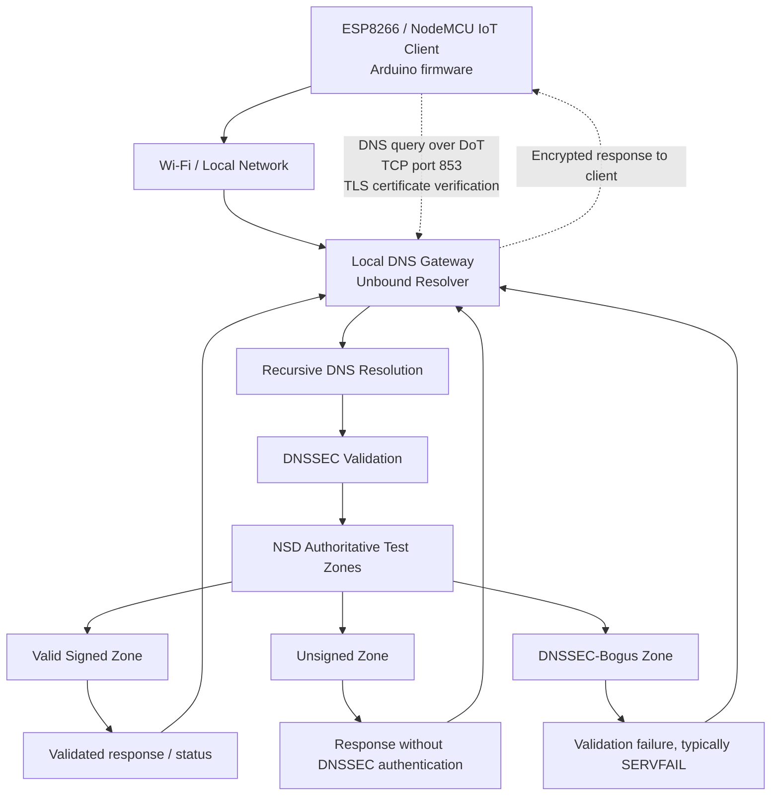

# PS-004 — Gateway-Assisted DNSSEC for ESP8266 IoT Devices

**AIORI-3 Hackathon · Team TC200 · Problem Statement PS-004**

> **Project status: Prototype in progress.** The ESP8266 connects to Wi-Fi, but end-to-end DNS-over-TLS (DoT) with certificate verification has not yet been demonstrated successfully. This README distinguishes configured components from work still in progress.

---
## Team Introduction Video

**Problem Statement:** PS-004 — Authenticated Gateway-Assisted DNSSEC for IoT Clients

**Video:** [Watch our AIORI-3 team introduction](https://youtu.be/wjA9g5x5s4w?si=8qdF-Wcldh8SVMxA)

## Table of Contents

- [Overview](#overview)
- [Problem Statement](#problem-statement)
- [Objectives](#objectives)
- [System Architecture](#system-architecture)
- [Workflow](#workflow)
- [Technology Stack](#technology-stack)
- [Repository Structure](#repository-structure)
- [Implementation Status](#implementation-status)
- [DNSSEC Test Plan](#dnssec-test-plan)
- [Setup and Build](#setup-and-build)
- [Gateway Validation](#gateway-validation)
- [Security Considerations](#security-considerations)
- [Limitations](#limitations)
- [Future Work](#future-work)
- [Team and Submission Materials](#team-and-submission-materials)

## Overview

Resource-constrained Internet of Things (IoT) devices, such as the ESP8266, have limited memory and processing capacity. This project explores a gateway-assisted approach to DNS security: the IoT device sends DNS queries to a local gateway over an encrypted connection, while the gateway performs DNSSEC validation.

The prototype brings together an ESP8266/NodeMCU client, Unbound as a validating recursive resolver, and NSD-hosted test zones. Planned test cases cover valid signed DNS data, unsigned data, and DNSSEC-bogus data.

## Problem Statement

Traditional DNS does not, by itself, authenticate the integrity of DNS responses. DNSSEC provides cryptographic validation of DNS data, but implementing the full validation process directly on a constrained IoT device can be challenging.

This project investigates whether a local gateway can perform DNSSEC validation on behalf of an ESP8266 client while DNS-over-TLS (DoT) protects communication between the device and gateway.

## Objectives

- Configure Unbound as a recursive resolver with DNSSEC validation.
- Prepare controlled DNS test zones for valid signed, unsigned, and DNSSEC-bogus responses.
- Establish a DNS-over-TLS connection from the ESP8266 to the gateway on port `853`.
- Keep certificate trust and hostname verification enabled.
- Test and document the expected handling of each DNSSEC case.
- Keep Wi-Fi credentials, private keys, and other secrets out of version control.

## System Architecture

The diagram below shows the intended system path. ESP8266-to-gateway DoT integration is still being tested.



### Architecture Components

| Component | Responsibility |
|---|---|
| ESP8266 / NodeMCU v2 | Sends DNS requests from the IoT device |
| Wi-Fi / local network | Provides connectivity between the client and gateway |
| Unbound | Recursive resolver and DNSSEC validator |
| NSD | Hosts authoritative local test zones |
| Test zones | Provide valid signed, unsigned, and DNSSEC-bogus test cases |
| CA certificate | Allows the client to trust the gateway certificate when correctly configured |

**Security distinction:** DNS-over-TLS protects the connection to the configured resolver. DNSSEC validates DNS data. They address different parts of the trust chain.

## Workflow

1. The ESP8266 joins the Wi-Fi network.
2. The client resolves the gateway hostname and opens a TLS connection to the gateway on port `853`.
3. The client verifies the gateway certificate against its configured CA trust anchor and checks the hostname.
4. Unbound receives the DNS query and performs recursive resolution and DNSSEC validation.
5. NSD provides the controlled authoritative records used by the test cases.
6. The gateway returns the response to the client through the encrypted connection.
7. The team records the response and validation outcome for each test case.

Steps 2–6 describe the intended end-to-end workflow. Successful ESP8266-to-gateway DoT and certificate verification remain pending.

## Technology Stack

| Technology | Use |
|---|---|
| ESP8266 / NodeMCU v2 | Constrained IoT client hardware |
| C++ / Arduino framework | ESP8266 firmware |
| PlatformIO | Build, upload, and serial monitoring |
| BearSSL / `WiFiClientSecure` | TLS client support in ESP8266 firmware |
| Unbound | Recursive DNS resolver and DNSSEC validation |
| NSD | Authoritative DNS server for controlled test zones |
| DNSSEC | Authentication and integrity validation for DNS data |
| DNS-over-TLS (DoT) | Encrypted transport to the local resolver |
| Ubuntu on WSL2 | Gateway and DNS service development environment |

## Repository Structure

```text
A3-PS004-TC200/
├── .vscode/
├── include/
├── lib/
├── src/
│   ├── main.cpp
│   └── ca_cert.h
├── test/
├── .gitignore
├── platformio.ini
├── README.md
└── A3-PS004-TC200 Authenticated Gateway-Assisted DNSSEC for IoT ClientS.pdf
```

`src/secrets.h` may be required locally, depending on the firmware configuration, but it is intentionally excluded from Git. Do not add credentials or private keys to this repository.

## Implementation Status

### Configured or implemented

- PlatformIO project created for the NodeMCU v2 / ESP8266.
- Firmware source committed to the repository.
- ESP8266 Wi-Fi connection succeeds in the current test setup.
- Unbound configuration passes `unbound-checkconf`.
- Unbound has a TLS service certificate and key configured.
- NSD test zones and DNSSEC test records have been prepared.
- Firmware is configured to use a CA trust anchor from `src/ca_cert.h`.
- `.gitignore` excludes the local secrets header and PlatformIO build output.

### In progress

- Making the gateway hostname resolve correctly from the ESP8266.
- Completing a successful DoT connection from the ESP8266.
- Confirming certificate-chain and hostname verification on the device.
- Running DNSSEC cases end to end and recording reproducible evidence.

**Current observed firmware behavior:** Wi-Fi connects, but DNS resolution for `gateway.lab` fails and TLS verification has not yet succeeded. This is an experimental prototype, not a completed end-to-end demonstration.

## DNSSEC Test Plan

| Test case | Expected behavior | Interpretation |
|---|---|---|
| Valid signed data | Resolution succeeds when the chain validates | Authenticated DNS data is accepted |
| Unsigned data | Resolution may succeed, depending on zone and resolver policy, but is not treated as DNSSEC-authenticated | Data is available without DNSSEC authentication |
| DNSSEC-bogus data | Validation failure, typically `SERVFAIL` | Invalidly signed data is rejected |

These are expected outcomes, not claims that every test has passed from the ESP8266. Mark a case as **PASS** only after capturing the actual response and supporting evidence.

For each run, record the query name and type, test-zone category, expected outcome, actual response, date, environment, and pass/fail status.

## Setup and Build

### Prerequisites

- Visual Studio Code
- PlatformIO IDE extension
- NodeMCU v2 / ESP8266 board and a USB data cable
- A Wi-Fi network accessible to the ESP8266 and the gateway
- A correctly configured gateway certificate and CA trust anchor

### Configure local secrets

If `src/main.cpp` requires `src/secrets.h`, create that file locally using the exact macro names expected by your firmware and your own Wi-Fi credentials. **Do not commit `src/secrets.h`.** Confirm that the CA certificate in `src/ca_cert.h` matches the authority that signed the gateway certificate.

### Build, upload, and monitor

Run these commands in the PlatformIO terminal from the project directory:

```bash
pio run
pio run --target upload
pio device monitor --baud 115200
```

If `pio` is not available on your PATH, use the PlatformIO CLI installed in your local PlatformIO Python environment. Close any existing serial monitor before uploading if the COM port is busy.

## Gateway Validation

Before testing from the ESP8266:

1. Run `unbound-checkconf` and resolve any configuration errors.
2. Confirm that Unbound is listening on the expected interface and DoT port (`853`).
3. Check that the gateway certificate contains the intended hostname in its Subject Alternative Name (SAN).
4. Confirm that the client trusts the correct CA certificate.
5. Test gateway reachability and hostname resolution from the client network.
6. Test TLS from a separate client with certificate and hostname verification enabled.
7. Query each DNSSEC test zone independently and record the actual resolver response.
8. Repeat the tests from the ESP8266 and save the serial output.

Publish only sanitized configuration examples. Never commit `gw.key`, `ca.key`, zone-signing private keys, Wi-Fi passwords, tokens, or other credentials.

## Security Considerations

- Do not disable TLS verification to work around certificate or hostname errors.
- The gateway hostname must resolve to a reachable address and match a name in the certificate's SAN.
- A trusted CA certificate and a valid hostname match are both required for authenticated TLS.
- DNSSEC validation and TLS transport security provide different protections; one does not replace the other.
- A CA certificate is not a private key, but its source and trust scope should be documented.
- Private keys, passwords, and tokens must remain outside version control.
- End-to-end DoT and DNSSEC behavior from the ESP8266 has not yet been demonstrated.

## Limitations

- The design depends on a reachable and correctly configured local gateway.
- DNS resolution and network routing must work before a hostname-based DoT connection can succeed.
- Certificate-chain validation and hostname matching must both succeed.
- Full ESP8266-to-gateway-to-DNSSEC integration remains in progress.
- The current prototype is not a production-ready IoT security solution.
- Performance claims should be added only after repeatable measurements have been collected.

## Future Work

- Resolve the gateway hostname reliably from the ESP8266 network.
- Demonstrate DoT with certificate-chain and hostname verification enabled.
- Run valid, unsigned, and DNSSEC-bogus test cases end to end.
- Capture repeatable serial logs and resolver-side evidence.
- Measure query latency, TLS setup time, memory use, and failure behavior.
- Add sanitized gateway configuration, test scripts, and a reproducible demo guide.
- Publish the team introduction video and add its link when available.

## Team and Submission Materials

- **Team code:** TC200
- **Hackathon:** AIORI-3
- **Problem statement:** PS-004
- **Firmware entry point:** `src/main.cpp`
- **PlatformIO configuration:** `platformio.ini`
- **Project presentation:** `A3-PS004-TC200 Authenticated Gateway-Assisted DNSSEC for IoT ClientS.pdf`
- **Team introduction video:** To be added after publication.

---

*This README documents the current state of the prototype. Update the implementation status and test results only when supported by fresh logs or reproducible test evidence.*
