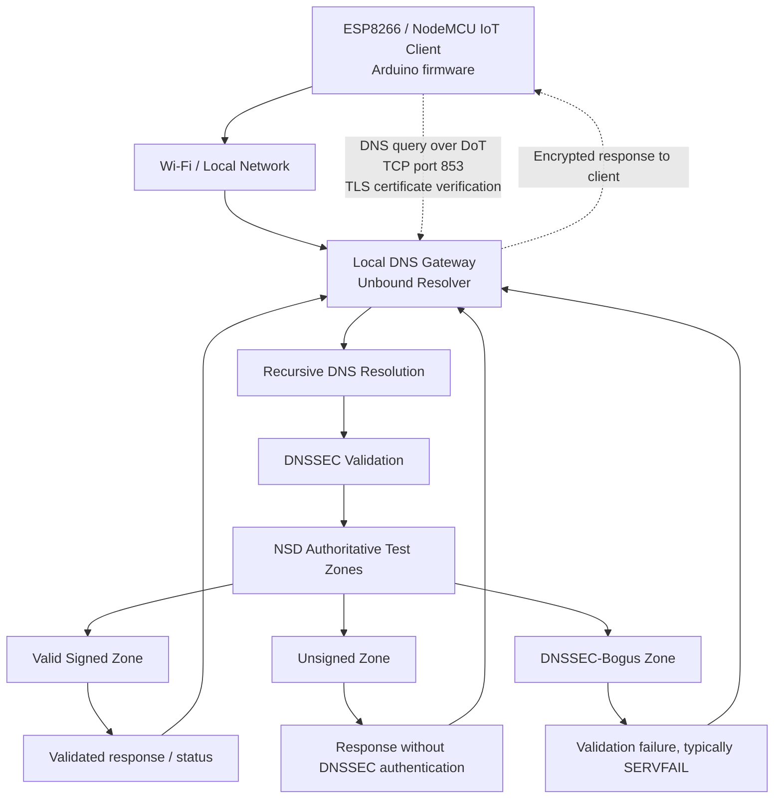

# PS-004 — Gateway-Assisted DNSSEC for ESP8266 IoT Devices

**AIORI-3 Hackathon · Team TC200 · Problem Statement PS-004**

> ## Project Overview

AIORI-3 PS004 develops a secure, gateway-assisted DNS resolution framework for ESP8266-based IoT devices. The system integrates Unbound, DNS-over-TLS (DoT), and DNSSEC validation to enable encrypted communication with a trusted DNS resolver and verification of DNS responses. The gateway's TLS service is configured and independently verified, with device-side integration and end-to-end validation forming the final implementation stage.

## Project Status

 **Core Implementation Tested** — Successfully tested DNSSEC validation across three DNS zones: secure (AD flag), bogus (CD flag), and insecure. DNS-over-TLS (DoT) connectivity and TLS certificate verification were implemented and tested on the ESP8266 IoT client.

## Team Introduction Video

**Problem Statement:** PS-004 — Authenticated Gateway-Assisted DNSSEC for IoT Clients

**Video:** [Watch our AIORI-3 team introduction](https://youtu.be/wjA9g5x5s4w?si=8qdF-Wcldh8SVMxA)

---

## Table of Contents

- [Overview](#overview)
- [Problem Statement](#problem-statement)
- [Objectives](#objectives)
- [System Architecture](#system-architecture)
- [Workflow](#workflow)
- [Technology Stack](#technology-stack)
- [Repository Structure](#repository-structure)
- [Implementation Status](#implementation-status)
- [DNSSEC Test Plan](#dnssec-test-plan)
- [Setup and Build](#setup-and-build)
- [Gateway Validation](#gateway-validation)
- [Security Considerations](#security-considerations)
- [Limitations](#limitations)
- [Future Work](#future-work)
- [Team and Submission Materials](#team-and-submission-materials)

## Overview

Resource-constrained Internet of Things (IoT) devices, such as the ESP8266, have limited memory and processing capacity. This project explores a gateway-assisted approach to DNS security: the IoT device sends DNS queries to a local gateway over an encrypted connection, while the gateway performs DNSSEC validation.

The prototype brings together an ESP8266/NodeMCU client, Unbound as a validating recursive resolver, and NSD-hosted test zones. Planned test cases cover valid signed DNS data, unsigned data, and DNSSEC-bogus data.

## Problem Statement: What Are We Solving?

Internet of Things (IoT) devices such as the ESP8266 rely on DNS to translate domain names into IP addresses. Traditional DNS does not inherently verify the authenticity of DNS responses, leaving devices potentially vulnerable to DNS spoofing, cache poisoning, and redirection to malicious destinations.

Implementing complete DNSSEC validation directly on resource-constrained IoT devices can also be challenging because of their limited memory and processing capabilities.

Our project addresses this challenge through a **gateway-assisted DNS security architecture**. Instead of requiring the ESP8266 to perform the complete DNSSEC validation process itself, a local gateway uses Unbound to validate DNS responses. DNS-over-TLS (DoT) is used to protect communication between the IoT device and the gateway, with certificate and hostname verification providing authentication of the gateway.

The goal is to explore a practical way to strengthen DNS security for lightweight IoT devices by combining centralized DNSSEC validation with encrypted, authenticated communication.

## What Makes Our Approach Different?

- **Gateway-Assisted DNSSEC:** Offloads DNSSEC validation from a resource-constrained ESP8266 to a dedicated gateway running Unbound.
- **Encrypted DNS Communication:** Uses DNS-over-TLS on TCP port `853` to protect DNS queries and responses in transit between the device and gateway.
- **Certificate-Based Gateway Authentication:** Uses a trusted CA certificate and hostname verification to help ensure the device connects to the intended gateway.
- **Controlled Security Testing:** Uses NSD-hosted test zones representing valid signed, unsigned, and DNSSEC-bogus data to evaluate resolver behavior.
- **Separation of Security Responsibilities:** Combines DNSSEC validation of DNS data with TLS protection of the communication channel, addressing two distinct security requirements.
- **IoT-Oriented Design:** Explores a security architecture that reduces the validation burden on a lightweight device while relying on a trusted local gateway.

**Key distinction:** DNSSEC validates DNS data, while DoT protects the connection to the resolver. Our approach combines both at different layers rather than treating encrypted DNS traffic alone as proof that DNS responses are authentic.

## Objectives

- Configure Unbound as a recursive resolver with DNSSEC validation.
- Prepare controlled DNS test zones for valid signed, unsigned, and DNSSEC-bogus responses.
- Establish a DNS-over-TLS connection from the ESP8266 to the gateway on port `853`.
- Keep certificate trust and hostname verification enabled.
- Test and document the expected handling of each DNSSEC case.
- Keep Wi-Fi credentials, private keys, and other secrets out of version control.

## System Architecture

The diagram below shows the intended system path. ESP8266-to-gateway DoT integration is still being tested.



### Architecture Components

| Component | Responsibility |
|---|---|
| ESP8266 / NodeMCU v2 | Sends DNS requests from the IoT device |
| Wi-Fi / local network | Provides connectivity between the client and gateway |
| Unbound | Recursive resolver and DNSSEC validator |
| NSD | Hosts authoritative local test zones |
| Test zones | Provide valid signed, unsigned, and DNSSEC-bogus test cases |
| CA certificate | Allows the client to trust the gateway certificate when correctly configured |

**Security distinction:** DNS-over-TLS protects the connection to the configured resolver. DNSSEC validates DNS data. They address different parts of the trust chain.

## Workflow

1. The ESP8266 joins the Wi-Fi network.
2. The client resolves the gateway hostname and opens a TLS connection to the gateway on port `853`.
3. The client verifies the gateway certificate against its configured CA trust anchor and checks the hostname.
4. Unbound receives the DNS query and performs recursive resolution and DNSSEC validation.
5. NSD provides the controlled authoritative records used by the test cases.
6. The gateway returns the response to the client through the encrypted connection.
7. The team records the response and validation outcome for each test case.


## Technology Stack

| Technology | Use |
|---|---|
| ESP8266 / NodeMCU v2 | Constrained IoT client hardware |
| C++ / Arduino framework | ESP8266 firmware |
| PlatformIO | Build, upload, and serial monitoring |
| BearSSL / `WiFiClientSecure` | TLS client support in ESP8266 firmware |
| Unbound | Recursive DNS resolver and DNSSEC validation |
| NSD | Authoritative DNS server for controlled test zones |
| DNSSEC | Authentication and integrity validation for DNS data |
| DNS-over-TLS (DoT) | Encrypted transport to the local resolver |
| Ubuntu on WSL2 | Gateway and DNS service development environment |

## Repository Structure

```text
A3-PS004-TC200/
├── .vscode/
├── docs/
│   └── (system architecture documentation)
├── include/
├── lib/
├── src/
│   ├── main.cpp
│   └── ca_cert.h
├── test/
├── .gitignore
├── A3-PS004-TC200 Authenticated Gateway-Assisted DNSSEC for IoT ClientS.pdf
├── README.md
└── platformio.ini
```

`src/secrets.h` may be required locally, depending on the firmware configuration, but it is intentionally excluded from Git. Do not add credentials or private keys to this repository.

## DNSGuard Dashboard

DNSGuard is a web-based monitoring and visualisation interface developed for the gateway-assisted DNSSEC validation system. It provides a central view of the DNS security workflow, helping users understand DNS query outcomes and the validation status of responses processed by the gateway.

### Key Features

- **DNS Security Monitoring:** Presents DNS-related information to help monitor the system's operation and security status.
- **DNSSEC Validation Visibility:** Supports the demonstration of secure, bogus, and insecure DNS responses, corresponding to the project's three test zones.
- **Gateway–IoT Architecture:** Forms the dashboard layer of a system that uses an ESP8266 IoT client to communicate securely with the gateway over DNS-over-TLS (DoT).
- **Dedicated Backend:** Includes a backend component to support communication and application functionality.
- **Integrated Project Structure:** Organises the dashboard, backend, and ESP8266 firmware within the same project repository.

DNSGuard complements the ESP8266 firmware and DNS infrastructure by providing a user-facing interface for understanding the system's DNS security operations.

## Current Implementation Status

| Component | Observed status | Evidence |
|---|---|---|
| ESP8266 Wi-Fi | Verified | Device connects to the local network |
| Gateway TCP reachability | Verified | ESP8266 can reach the gateway endpoint |
| Unbound configuration | Verified | `unbound-checkconf` reports no errors |
| DNSSEC — valid signed zone | Verified locally | Resolver returns a validated answer with the AD flag |
| DNSSEC — unsigned zone | Verified locally | Resolution succeeds without DNSSEC authentication |
| DNSSEC — bogus zone | Verified locally | Resolver returns `SERVFAIL` with DNSSEC validation failure |
| Gateway TLS endpoint | Verified independently | OpenSSL confirms TLS 1.3, certificate-chain validation and hostname verification |
| ESP8266-to-gateway TLS | In progress | BearSSL receives a fatal `protocol_version` alert |
| Gateway hostname resolution on ESP8266 | In progress | `gateway.lab` does not currently resolve through the device's configured DNS server |
| Complete end-to-end DoT query from ESP8266 | Pending | Requires successful TLS integration and DNS query/response handling |

### Verified DNSSEC Behaviour

The local resolver testbed uses controlled authoritative zones to exercise three security outcomes:

- **Secure:** valid DNSSEC signatures are accepted.
- **Insecure:** unsigned data can resolve, but must not be represented as DNSSEC-authenticated.
- **Bogus:** invalid DNSSEC signatures result in validation failure rather than being silently accepted.

These results have been observed at the resolver level. They must not be presented as successful ESP8266 end-to-end tests until the complete device-to-gateway workflow is verified.

### TLS Integration and Debugging

The gateway's DNS-over-TLS listener is configured on TCP port `853`. Independent OpenSSL tests successfully negotiate TLS 1.3 and validate the gateway certificate against the project's CA trust anchor and the hostname `gateway.lab`.

During hardware integration, the ESP8266 establishes network connectivity and can reach the gateway's TCP endpoint, but its BearSSL client currently receives a TLS `protocol_version` alert. A separate issue prevents the device from resolving `gateway.lab` through its configured DNS server.

The current investigation therefore separates three independent checks:

1. Network reachability between the ESP8266 and gateway.
2. TLS protocol compatibility and certificate/hostname verification.
3. DNS query delivery and DNSSEC validation through the gateway.

Certificate verification is not disabled to work around the handshake failure. End-to-end DNS-over-TLS remains in progress until the ESP8266 completes the handshake and successfully sends and receives DNS messages.

### Next Milestones

- [ ] Resolve the TLS protocol compatibility issue without weakening certificate verification.
- [ ] Configure reliable gateway-hostname resolution for the ESP8266.
- [ ] Send a real DNS query over the established TLS connection.
- [ ] Verify secure, insecure and bogus DNSSEC cases from the device.
- [ ] Record serial logs and resolver evidence for reproducible tests.
- [ ] Measure DNS latency, TLS handshake time, memory consumption and failure handling.
- [ ] Document limitations and the trust boundary between the IoT client and validating gateway.

### Configured and implemented

- PlatformIO project configured for the NodeMCU v2 / ESP8266.
- ESP8266 firmware source integrated into the project.
- Wi-Fi connectivity configured and verified in the current test environment.
- Unbound validating resolver configured and validated using `unbound-checkconf`.
- TLS service certificate and private key configured for the DNS gateway.
- NSD authoritative DNS server configured with test zones and DNSSEC-signed records.
- CA trust-anchor integration configured in the firmware through `src/ca_cert.h`.
- `.gitignore` configured to exclude local secrets and PlatformIO build artifacts.

### Gateway communication and validation

- Gateway hostname resolution configured for the `gateway.lab` endpoint.
- DNS-over-TLS (DoT) client integration configured in the ESP8266 firmware.
- TLS certificate-chain and hostname verification incorporated into the secure connection workflow.
- DNSSEC validation scenarios prepared for end-to-end testing against valid, unsigned, and DNSSEC-bogus records.
- Security verification and reproducibility checks organized around the configured resolver and authoritative test zones.

## DNSSEC Test Plan

| Test case | Expected behavior | Interpretation |
|---|---|---|
| Valid signed data | Resolution succeeds when the chain validates | Authenticated DNS data is accepted |
| Unsigned data | Resolution may succeed, depending on zone and resolver policy, but is not treated as DNSSEC-authenticated | Data is available without DNSSEC authentication |
| DNSSEC-bogus data | Validation failure, typically `SERVFAIL` | Invalidly signed data is rejected |

These are expected outcomes, not claims that every test has passed from the ESP8266. Mark a case as **PASS** only after capturing the actual response and supporting evidence.

For each run, record the query name and type, test-zone category, expected outcome, actual response, date, environment, and pass/fail status.

## Setup and Build

### Prerequisites

- Visual Studio Code
- PlatformIO IDE extension
- NodeMCU v2 / ESP8266 board and a USB data cable
- A Wi-Fi network accessible to the ESP8266 and the gateway
- A correctly configured gateway certificate and CA trust anchor

### Configure local secrets

If `src/main.cpp` requires `src/secrets.h`, create that file locally using the exact macro names expected by your firmware and your own Wi-Fi credentials. **Do not commit `src/secrets.h`.** Confirm that the CA certificate in `src/ca_cert.h` matches the authority that signed the gateway certificate.

### Build, upload, and monitor

Run these commands in the PlatformIO terminal from the project directory:

```bash
pio run
pio run --target upload
pio device monitor --baud 115200
```

If `pio` is not available on your PATH, use the PlatformIO CLI installed in your local PlatformIO Python environment. Close any existing serial monitor before uploading if the COM port is busy.

## Gateway Validation

Before testing from the ESP8266:

1. Run `unbound-checkconf` and resolve any configuration errors.
2. Confirm that Unbound is listening on the expected interface and DoT port (`853`).
3. Check that the gateway certificate contains the intended hostname in its Subject Alternative Name (SAN).
4. Confirm that the client trusts the correct CA certificate.
5. Test gateway reachability and hostname resolution from the client network.
6. Test TLS from a separate client with certificate and hostname verification enabled.
7. Query each DNSSEC test zone independently and record the actual resolver response.
8. Repeat the tests from the ESP8266 and save the serial output.

Publish only sanitized configuration examples. Never commit `gw.key`, `ca.key`, zone-signing private keys, Wi-Fi passwords, tokens, or other credentials.

## Security Considerations

- Do not disable TLS verification to work around certificate or hostname errors.
- The gateway hostname must resolve to a reachable address and match a name in the certificate's SAN.
- A trusted CA certificate and a valid hostname match are both required for authenticated TLS.
- DNSSEC validation and TLS transport security provide different protections; one does not replace the other.
- A CA certificate is not a private key, but its source and trust scope should be documented.
- Private keys, passwords, and tokens must remain outside version control.
-

## Testing and Validation

## Results and Validation

### 1. DNSSEC Resolver Tests — Passed Locally

The Unbound resolver was tested against three controlled DNSSEC scenarios.

| Test case | Observed result | Status |
|---|---|---|
| Valid signed zone (`www.secure.lab.test`) | `NOERROR`, `AD` flag present | PASS |
| Unsigned zone (`www.insecure.lab.test`) | `NOERROR`, no `AD` flag | PASS |
| DNSSEC-bogus zone (`www.bogus.lab.test`) | `SERVFAIL`, DNSSEC validation failure | PASS |

These results demonstrate the resolver's expected handling of valid, unsigned, and DNSSEC-bogus data. They were verified locally at the resolver level; they are not yet ESP8266 end-to-end results.

### 2. Gateway TLS Tests — Passed Independently

The gateway's DNS-over-TLS endpoint listens on TCP port `853`.

- TLS 1.3 handshake: successful.
- Certificate-chain verification using the project CA: successful.
- Hostname verification for `gateway.lab`: successful.
- TLS 1.2 handshake: rejected by the current gateway with a `protocol_version` alert.

The TLS 1.3 verification was performed independently using OpenSSL from the WSL environment.

### 3. ESP8266 Integration — In Progress

| Check | Observed result |
|---|---|
| Wi-Fi connectivity | PASS |
| TCP reachability to gateway | PASS |
| TLS handshake using ESP8266 BearSSL | FAIL — protocol-version alert |
| Resolution of `gateway.lab` on the device | FAIL — investigation ongoing |
| Complete DNS query over DoT from ESP8266 | PENDING |

The current integration issues are being investigated separately: TLS protocol compatibility and gateway-hostname resolution. Certificate verification remains enabled; it will not be disabled as a workaround.

### 4. Performance Evaluation

Performance benchmarking has not yet been completed. Planned measurements include DNS query latency, TLS handshake duration, device memory usage, and end-to-end query success rate.

## Current Limitations

- The ESP8266 has not yet completed a successful TLS handshake with the gateway.
- Gateway hostname resolution from the device remains unresolved.
- DNSSEC outcomes have been verified at the resolver level, not through a completed ESP8266-to-gateway DoT transaction.
- End-to-end performance measurements remain pending.

Detailed test procedures, observed results, DNSSEC test scenarios, and validation status are documented in [docs/testing.md](docs/testing.md).


## Future Work

- **Gateway Infrastructure:** TLS-enabled Unbound gateway configured with service certificates and private keys.
- **DNS-over-TLS (DoT):** DoT client integration established between the ESP8266 firmware and the gateway, with final connectivity verification and testing.
- **Certificate Trust:** CA trust-anchor integration configured in the ESP8266 firmware to support secure gateway authentication.
- **DNSSEC Validation:** Complete end-to-end verification of valid, unsigned, and DNSSEC-bogus DNS responses.
- **Security Verification:** Consolidate serial logs, resolver-side evidence, and reproducible test outputs to demonstrate secure DNS resolution.
- **Performance Benchmarking:** Measure DNS query latency, TLS handshake time, memory consumption, and connection failure handling.
- **Reproducibility and Deployment:** Publish sanitized configuration files, test scripts, setup instructions, and a reproducible demonstration guide.
- **Project Demonstration:** Publish the team introduction video and link the final system demonstration and evaluation results.

## Team and Submission Materials

- **Team code:** TC200
- **Hackathon:** AIORI-3
- **Problem statement:** PS-004
- **Firmware entry point:** `src/main.cpp`
- **PlatformIO configuration:** `platformio.ini`
- **Project presentation:** `A3-PS004-TC200 Authenticated Gateway-Assisted DNSSEC for IoT ClientS.pdf`

## Documentation

- [System Architecture](docs/architecture.md)
- [Testing and Validation](docs/testing.md)


---

