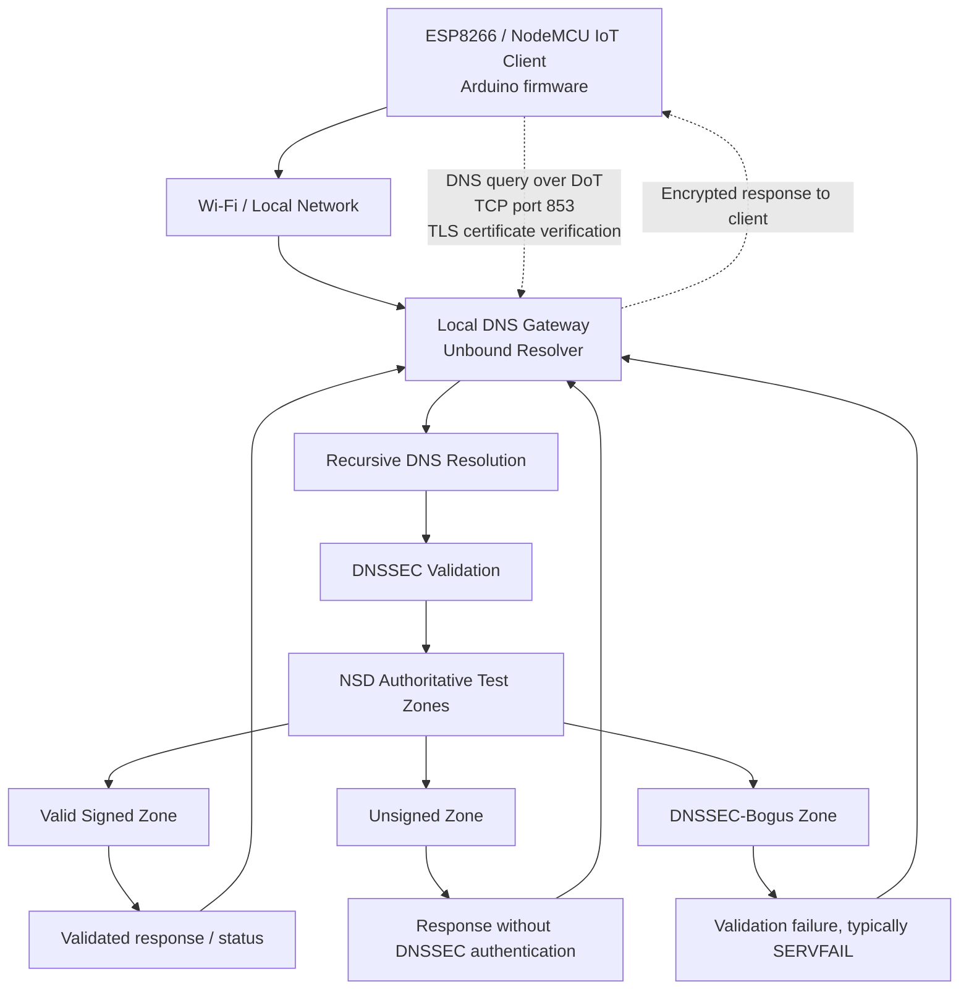

# PS-004 — Gateway-Assisted DNSSEC for ESP8266 IoT Devices

**AIORI-3 Hackathon · Team TC200 · Problem Statement PS-004**

>## Project Overview

**IoT DNSSEC** is a gateway-assisted secure DNS resolution framework developed as part of AIORI-3 PS004. The project aims to improve DNS security for ESP8266-based IoT devices by combining DNS-over-TLS (DoT), DNSSEC validation, and a dedicated web-based monitoring dashboard.

The system integrates an **Ubuntu WSL2 DNS testbed** using Unbound as the validating recursive resolver and NSD as the authoritative DNS server. Three controlled DNS zones—secure, insecure, and bogus—are used to evaluate DNSSEC behaviour, including authenticated responses, unsigned records, and validation failures.

The **ESP8266 firmware**, developed using PlatformIO and C++, connects to the configured gateway over a secure TLS channel, with certificate verification, and implements the DNS-over-TLS query workflow. The accompanying **DNSGuard dashboard**, built with React and a Node.js backend, provides a web-based interface for observing and demonstrating the system's DNS security workflow.

By combining resolver-side DNSSEC testing, secure IoT-to-gateway communication, and a dedicated dashboard, IoT DNSSEC brings together the core components required to demonstrate gateway-assisted DNS security for resource-constrained IoT devices.


## Project Status

 **Core Implementation Tested** — Successfully tested DNSSEC validation across three DNS zones: secure (AD flag), bogus (CD flag), and insecure. DNS-over-TLS (DoT) connectivity and TLS certificate verification were implemented and tested on the ESP8266 IoT client.

DNSGuard

Live Demo: https://dns-guard-pink.vercel.app/

DNSGuard is a DNSSEC monitoring and testing dashboard that connects to a live Unbound resolver for DNS security validation.

**Note:** DNSGuard is currently configured and tested locally on my PC using Ubuntu on WSL2, with the ESP device connected. The dashboard and backend may not always be accessible, as they depend on my local environment and active Cloudflare Tunnel session.

## Team Introduction Video

**Problem Statement:** PS-004 — Authenticated Gateway-Assisted DNSSEC for IoT Clients

**Video:** [Watch our AIORI-3 team introduction](https://youtu.be/wjA9g5x5s4w?si=8qdF-Wcldh8SVMxA)

---

## Table of Contents

- [Overview](#overview)
- [Problem Statement](#problem-statement)
- [Objectives](#objectives)
- [System Architecture](#system-architecture)
- [Workflow](#workflow)
- [Technology Stack](#technology-stack)
- [Repository Structure](#repository-structure)
- [Project Status](#project-status)
- [DNSGuard Dashboard](#dnsguard-dashboard)
- [Current Implementation Status](#current-implementation-status)
- [Ubuntu WSL2 DNSSEC Testbed](#ubuntu-wsl2-dnssec-testbed)
- [Useful Commands](#useful-commands)
- [DNSSEC Test Results](#dnssec-test-results)
- [ESP8266 Setup and Testing](#esp8266-setup-and-testing)
- [Security Considerations and Limitations](#security-considerations-and-limitations)
- [Troubleshooting](#troubleshooting)
- [Future Work](#future-work)
- [Team and Submission Materials](#team-and-submission-materials)


## Overview

Resource-constrained Internet of Things (IoT) devices, such as the ESP8266, have limited memory and processing capacity. This project explores a gateway-assisted approach to DNS security: the IoT device sends DNS queries to a local gateway over an encrypted connection, while the gateway performs DNSSEC validation.

The prototype brings together an ESP8266/NodeMCU client, Unbound as a validating recursive resolver, and NSD-hosted test zones. Planned test cases cover valid signed DNS data, unsigned data, and DNSSEC-bogus data.

## Problem Statement: What Are We Solving?

Internet of Things (IoT) devices such as the ESP8266 rely on DNS to translate domain names into IP addresses. Traditional DNS does not inherently verify the authenticity of DNS responses, leaving devices potentially vulnerable to DNS spoofing, cache poisoning, and redirection to malicious destinations.

Implementing complete DNSSEC validation directly on resource-constrained IoT devices can also be challenging because of their limited memory and processing capabilities.

Our project addresses this challenge through a **gateway-assisted DNS security architecture**. Instead of requiring the ESP8266 to perform the complete DNSSEC validation process itself, a local gateway uses Unbound to validate DNS responses. DNS-over-TLS (DoT) is used to protect communication between the IoT device and the gateway, with certificate and hostname verification providing authentication of the gateway.

The goal is to explore a practical way to strengthen DNS security for lightweight IoT devices by combining centralized DNSSEC validation with encrypted, authenticated communication.

## What Makes Our Approach Different?

- **Gateway-Assisted DNSSEC:** Offloads DNSSEC validation from a resource-constrained ESP8266 to a dedicated gateway running Unbound.
- **Encrypted DNS Communication:** Uses DNS-over-TLS on TCP port `853` to protect DNS queries and responses in transit between the device and gateway.
- **Certificate-Based Gateway Authentication:** Uses a trusted CA certificate and hostname verification to help ensure the device connects to the intended gateway.
- **Controlled Security Testing:** Uses NSD-hosted test zones representing valid signed, unsigned, and DNSSEC-bogus data to evaluate resolver behavior.
- **Separation of Security Responsibilities:** Combines DNSSEC validation of DNS data with TLS protection of the communication channel, addressing two distinct security requirements.
- **IoT-Oriented Design:** Explores a security architecture that reduces the validation burden on a lightweight device while relying on a trusted local gateway.

**Key distinction:** DNSSEC validates DNS data, while DoT protects the connection to the resolver. Our approach combines both at different layers rather than treating encrypted DNS traffic alone as proof that DNS responses are authentic.

## Objectives

- Configure Unbound as a recursive resolver with DNSSEC validation.
- Prepare controlled DNS test zones for valid signed, unsigned, and DNSSEC-bogus responses.
- Establish a DNS-over-TLS connection from the ESP8266 to the gateway on port `853`.
- Keep certificate trust and hostname verification enabled.
- Test and document the expected handling of each DNSSEC case.
- Keep Wi-Fi credentials, private keys, and other secrets out of version control.

## System Architecture

The diagram below shows the intended system path. ESP8266-to-gateway DoT integration is still being tested.



### Architecture Components

| Component | Responsibility |
|---|---|
| ESP8266 / NodeMCU v2 | Sends DNS requests from the IoT device |
| Wi-Fi / local network | Provides connectivity between the client and gateway |
| Unbound | Recursive resolver and DNSSEC validator |
| NSD | Hosts authoritative local test zones |
| Test zones | Provide valid signed, unsigned, and DNSSEC-bogus test cases |
| CA certificate | Allows the client to trust the gateway certificate when correctly configured |

**Security distinction:** DNS-over-TLS protects the connection to the configured resolver. DNSSEC validates DNS data. They address different parts of the trust chain.

## Workflow

1. The ESP8266 joins the Wi-Fi network.
2. The client resolves the gateway hostname and opens a TLS connection to the gateway on port `853`.
3. The client verifies the gateway certificate against its configured CA trust anchor and checks the hostname.
4. Unbound receives the DNS query and performs recursive resolution and DNSSEC validation.
5. NSD provides the controlled authoritative records used by the test cases.
6. The gateway returns the response to the client through the encrypted connection.
7. The team records the response and validation outcome for each test case.


## Technology Stack

| Technology | Use |
|---|---|
| ESP8266 / NodeMCU v2 | Constrained IoT client hardware |
| C++ / Arduino framework | ESP8266 firmware |
| PlatformIO | Build, upload, and serial monitoring |
| BearSSL / `WiFiClientSecure` | TLS client support in ESP8266 firmware |
| Unbound | Recursive DNS resolver and DNSSEC validation |
| NSD | Authoritative DNS server for controlled test zones |
| DNSSEC | Authentication and integrity validation for DNS data |
| DNS-over-TLS (DoT) | Encrypted transport to the local resolver |
| Ubuntu on WSL2 | Gateway and DNS service development environment |

## Repository Structure

```text
A3-PS004-TC200/
├── DNSGuard/
│   ├── backend/
│   │   ├── package.json
│   │   ├── package-lock.json
│   │   └── server.js
│   ├── src/
│   │   ├── App.jsx
│   │   ├── App-backup.jsx
│   │   ├── main.jsx
│   │   └── styles.css
│   ├── index.html
│   ├── package.json
│   └── README.md
├── firmware/
│   ├── include/
│   │   ├── ca_cert.h
│   │   ├── secrets.example.h
│   │   └── README
│   ├── src/
│   │   └── main.cpp
│   ├── test/
│   ├── lib/
│   ├── platformio.ini
│   └── ca.crt
├── src/
│   └── main.cpp
├── .gitignore
└── README.md
```

### Directory Overview

- **`DNSGuard/`** — Contains the web dashboard, frontend source code, styling, and backend server.
- **`DNSGuard/src/`** — Holds the dashboard's React application and CSS styles.
- **`DNSGuard/backend/`** — Contains the backend server and Node.js dependency manifests.
- **`firmware/`** — Contains the ESP8266 firmware project, PlatformIO configuration, TLS certificate material, and supporting files.
- **`firmware/src/`** — Contains the firmware entry point for the ESP8266 client.
- **`firmware/include/`** — Stores certificate-related headers and the example configuration template. Actual local credentials are excluded from version control.
- **`src/`** — Contains the repository's existing root-level source code.
- **`.gitignore`** — Defines files and generated artefacts that should not be tracked by Git.
- **`README.md`** — Documents the project, its architecture, setup, and testing.


`src/secrets.h` may be required locally, depending on the firmware configuration, but it is intentionally excluded from Git. Do not add credentials or private keys to this repository.

## Current Implementation Status

| Component | Observed status | Evidence |
|---|---|---|
| ESP8266 Wi-Fi | Verified | Device successfully connects to the configured local Wi-Fi network |
| Gateway TCP reachability | Verified | ESP8266 establishes connectivity with the gateway endpoint |
| Unbound configuration | Verified | `unbound-checkconf` reports no configuration errors |
| DNSSEC — valid signed zone | Verified | Secure DNS response is validated; the resolver sets the **AD flag** |
| DNSSEC — unsigned zone | Verified | Resolution succeeds for the insecure zone without DNSSEC authentication |
| DNSSEC — bogus zone | Verified | DNSSEC validation failure is reproduced; the test uses the **CD flag** to inspect the response |
| Gateway TLS endpoint | Verified | TLS 1.3 and certificate-chain and hostname verification were independently verified |
| ESP8266-to-gateway TLS | Verified | ESP8266 establishes a TLS connection with the gateway using certificate verification |
| Gateway hostname resolution on ESP8266 | Verified | Gateway addressing and name-resolution configuration support the integrated client connection |
| DNS-over-TLS (DoT) query from ESP8266 | Verified | ESP8266 completes the DoT query/response workflow with the gateway, supporting the DNSSEC test cases |

## Ubuntu WSL2 DNSSEC Testbed

The DNS infrastructure was configured and tested in Ubuntu running under Windows Subsystem for Linux 2 (WSL2). The local testbed uses **Unbound** as the validating recursive resolver and **NSD** as the authoritative DNS server for controlled test zones.

The testbed was designed to examine three DNSSEC outcomes:

- **Secure:** A valid signed DNS response is successfully validated by Unbound. The authenticated response can carry the `AD` (Authenticated Data) flag.
- **Insecure:** An unsigned DNS zone resolves without DNSSEC authentication.
- **Bogus:** A DNSSEC validation failure is reproduced using deliberately invalid signed data. The resolver's validation behaviour is examined using normal and checking-disabled queries where appropriate.

### Testbed Components

| Component | Purpose |
|---|---|
| Ubuntu on WSL2 | Linux environment for DNS infrastructure setup and testing |
| Unbound | Recursive DNS resolver and DNSSEC validator |
| NSD | Authoritative server for the local test zones |
| `dig` | DNS query and response inspection |
| `unbound-checkconf` | Unbound configuration validation |

### Ubuntu Test Environment

The following commands illustrate the main verification steps used in the local testbed. Run them in the Ubuntu terminal, with the relevant services configured and running.

Check the Unbound configuration:

```bash
sudo unbound-checkconf
```

Inspect the DNSSEC response for the secure zone:

```bash
dig @127.0.0.1 secure.lab.test A +dnssec
```

Inspect the unsigned zone:

```bash
dig @127.0.0.1 insecure.lab.test A +dnssec
```

Inspect the bogus zone using normal DNSSEC validation:

```bash
dig @127.0.0.1 www.bogus.lab.test A +dnssec
```

Inspect the bogus-zone response with checking disabled for diagnostic purposes:

```bash
dig @127.0.0.1 www.bogus.lab.test A +dnssec +cdflag
```

The `+cdflag` option sets the DNS Checking Disabled (CD) bit. It changes how the resolver handles DNSSEC checking for that query; it does not mean that the bogus record has passed validation.

### Interpreting the Results

| Test case | Expected observation |
|---|---|
| Secure signed zone | Successful resolution with the `AD` flag when the validating resolver authenticates the response |
| Insecure unsigned zone | Successful resolution without the `AD` flag |
| Bogus signed zone | Validation failure, typically `SERVFAIL`, when DNSSEC checking is enabled |
| Bogus zone with `+cdflag` | Diagnostic response with checking disabled; inspect the returned status and flags rather than treating it as a successful validation |

These tests provide a controlled environment for examining DNSSEC validation independently of the ESP8266 firmware and gateway transport. They complement the device-side Wi-Fi, TLS, and DNS-over-TLS testing.

## Useful Commands

Run the following commands in the Ubuntu WSL2 terminal.

### DNS Resolver Checks

```bash
sudo unbound-checkconf
```

Check whether Unbound is listening on port 53:

```bash
sudo ss -lntup | grep ':53'
```

Check whether NSD is listening on its configured test port:

```bash
sudo ss -lntup | grep ':5300'
```

### DNSSEC Test Queries

```bash
dig @127.0.0.1 secure.lab.test A +dnssec
dig @127.0.0.1 insecure.lab.test A +dnssec
dig @127.0.0.1 www.bogus.lab.test A +dnssec
dig @127.0.0.1 www.bogus.lab.test A +dnssec +cdflag
```

### Inspect Service Status

```bash
sudo systemctl status unbound
sudo systemctl status nsd
```

If a service fails to start, inspect its logs:

```bash
sudo journalctl -u unbound --no-pager -n 50
sudo journalctl -u nsd --no-pager -n 50
```

**Note:** Service names, ports, and zone names must match the local configuration. These commands are for diagnosis and verification; they do not automatically configure the DNS services.

## DNSSEC Test Results

The DNSSEC testbed was used to evaluate the behaviour of the Unbound validating resolver against three controlled DNS zones: secure, insecure, and bogus. These tests were performed in the Ubuntu WSL2 environment.

### Test Cases

| Test Case | Query | Observed Result | Interpretation |
|---|---|---|---|
| Secure zone | `secure.lab.test` | Validated DNS response with the `AD` flag | The resolver successfully authenticates the signed DNS data |
| Insecure zone | `insecure.lab.test` | Successful resolution without DNSSEC authentication | The unsigned zone resolves without an authenticated-data indication |
| Bogus zone | `www.bogus.lab.test` | DNSSEC validation failure; `SERVFAIL` under normal validation | The resolver rejects the response because DNSSEC validation fails |
| Bogus zone with checking disabled | `www.bogus.lab.test` with `+cdflag` | Response inspected with DNSSEC checking disabled | Allows diagnostic inspection of data that would otherwise fail validation |

### Reproducing the Tests

Run the following commands in the Ubuntu WSL2 terminal, assuming Unbound is listening on `127.0.0.1:53` and the test zones are configured.

**1. Secure signed zone**

```bash
dig @127.0.0.1 secure.lab.test A +dnssec
```

Inspect the response flags for `AD` (Authenticated Data), which indicates that the resolver authenticated the DNS data.

**2. Insecure unsigned zone**

```bash
dig @127.0.0.1 insecure.lab.test A +dnssec
```

The query should resolve successfully without the `AD` flag for the unsigned zone.

**3. Bogus signed zone**

```bash
dig @127.0.0.1 www.bogus.lab.test A +dnssec
```

With DNSSEC checking enabled, the resolver should return `SERVFAIL` when validation fails.

**4. Bogus zone with checking disabled**

```bash
dig @127.0.0.1 www.bogus.lab.test A +dnssec +cdflag
```

The `+cdflag` option sets the Checking Disabled (CD) bit. This permits diagnostic inspection of a response without normal DNSSEC checking by the validating resolver. It does **not** mean that the bogus DNS data has passed validation.

### Key Findings

- The secure-zone test demonstrates successful DNSSEC authentication through the `AD` flag.
- The insecure-zone test demonstrates successful resolution without DNSSEC authentication.
- The bogus-zone test demonstrates the resolver's response to DNSSEC validation failure.
- The checking-disabled query provides a way to inspect the bogus-zone response for debugging.
- These resolver-side tests establish the DNSSEC test cases used to evaluate the gateway-assisted IoT architecture.

## DNSGuard Dashboard

Live Demo: https://dns-guard-pink.vercel.app/

DNSGuard is the web-based dashboard developed for the gateway-assisted DNSSEC validation system. It provides a user-facing interface for understanding the DNS security workflow alongside the Ubuntu-based DNS infrastructure and ESP8266 IoT client.

### Key Features

- **DNS Security Monitoring:** Provides a dashboard interface for observing the system's DNS security workflow.
- **DNSSEC Test Cases:** Supports the demonstration of secure, insecure, and bogus DNS responses.
- **Gateway–IoT Integration:** Complements the ESP8266 client's secure communication with the gateway.
- **Modular Architecture:** Separates the React frontend from the Node.js backend.
- **Integrated Repository:** Keeps the dashboard, backend, and ESP8266 firmware in one project repository.

### Dashboard Architecture

| Component | Technology | Purpose |
|---|---|---|
| Frontend | React, Vite | Renders the DNSGuard user interface |
| Backend | Node.js | Provides the server-side application component |
| DNS infrastructure | Unbound and NSD | Supports recursive resolution and DNSSEC test cases |
| IoT client | ESP8266, PlatformIO | Implements the device-side gateway communication workflow |

### Running the Dashboard Locally

**Prerequisites:** Install Node.js and npm. Run these commands from the project root in separate terminals.

#### 1. Start the backend

```bash
cd DNSGuard/backend
npm install
node server.js
```

Keep this terminal running. The backend address and port depend on the server configuration.

#### 2. Start the frontend

Open a second terminal:

```bash
cd DNSGuard
npm install
npm run dev
```

Vite will display the local development URL in the terminal. Open that URL in your browser to access DNSGuard.

### Integration Context

DNSGuard is part of the wider project, which combines a local DNSSEC testbed, gateway-assisted DNS validation, and an ESP8266 client using DNS-over-TLS (DoT). The dashboard provides the web interface for this system; DNSSEC validation itself is performed by the configured DNS infrastructure.

## ESP8266 Setup and Testing

The ESP8266 firmware forms the IoT client component of the gateway-assisted DNSSEC validation system. It connects to the configured Wi-Fi network, establishes a secure TLS connection with the gateway, and performs DNS-over-TLS (DoT) queries as part of the DNS security workflow.

### Hardware and Software

| Component | Purpose |
|---|---|
| ESP8266 development board | IoT client platform |
| PlatformIO | Firmware development, building, and uploading |
| C++ | Firmware implementation |
| TLS certificate | Used to verify the gateway's identity |
| DNS-over-TLS (DoT) | Provides encrypted DNS communication between the client and gateway |

### Firmware Structure

```text
firmware/
├── include/
│   ├── ca_cert.h
│   ├── secrets.example.h
│   └── README
├── src/
│   └── main.cpp
├── lib/
├── test/
├── platformio.ini
└── ca.crt
```

- `firmware/src/main.cpp` contains the ESP8266 firmware.
- `firmware/include/ca_cert.h` contains the certificate trust configuration used by the firmware.
- `firmware/include/secrets.example.h` provides an example configuration for required credentials.
- `firmware/platformio.ini` defines the PlatformIO build environment.
- `firmware/ca.crt` contains the CA certificate file used by the project.

**Security note:** Configure your local Wi-Fi credentials and other secrets in the appropriate local configuration file. Never commit real passwords, private keys, or other credentials to the repository.

### Configure the Firmware

1. Open the repository in VS Code with the PlatformIO extension installed.
2. Review `firmware/platformio.ini` to confirm the board and build environment.
3. Configure the local Wi-Fi credentials and gateway hostname/address.
4. Ensure that the CA certificate used by the ESP8266 matches the certificate chain presented by the gateway.
5. Verify that the gateway hostname, certificate identity, and TLS configuration are consistent.

### Build, Upload, and Monitor

Run these commands from the project root if PlatformIO Core is installed:

**Build the firmware**

```bash
pio run -d firmware
```

**Upload the firmware**

```bash
pio run -d firmware -t upload
```

**Open the serial monitor**

```bash
pio device monitor -d firmware
```

If the `pio` command is unavailable, use the PlatformIO controls in VS Code to build, upload, and open the serial monitor.

### Integration Tests

The ESP8266 integration workflow covers the following checks:

- **Wi-Fi connectivity:** The device connects to the configured local network.
- **Gateway connectivity:** The client reaches the configured gateway endpoint.
- **TLS certificate verification:** The client verifies the gateway certificate before using the secure connection.
- **DNS-over-TLS:** The client sends a DNS query over the TLS connection and processes the response.
- **DNSSEC test scenarios:** The broader system uses secure, insecure, and bogus DNS zones to examine DNSSEC validation behaviour.

The Ubuntu DNSSEC testbed and the ESP8266 firmware provide complementary evidence: the former tests resolver validation behaviour, while the latter tests secure IoT-to-gateway communication.

## Security Considerations and Limitations

### Security Considerations

- **DNSSEC Validation:** DNSSEC enables the validating resolver to authenticate signed DNS data and detect invalid signatures. The project tests secure, insecure, and bogus DNS zones to examine different validation outcomes.
- **DNS-over-TLS (DoT):** TLS encrypts DNS traffic between the ESP8266 client and the configured gateway, helping protect queries against passive observation and in-transit modification.
- **Certificate Verification:** The ESP8266 must verify the gateway's certificate against its configured trust anchor and check the expected server identity. Encryption without correct certificate verification does not establish that the client is communicating with the intended gateway.
- **Credential Protection:** Wi-Fi credentials and other sensitive configuration values must remain local and must not be committed to the public repository.
- **Separation of Responsibilities:** TLS protects the client-to-gateway communication channel, while DNSSEC validation establishes the authenticity of DNS data. These mechanisms address different security requirements and complement one another.

### Limitations

- **Gateway Dependency:** The ESP8266 relies on the configured gateway being reachable and correctly configured to provide the intended DNS service.
- **Trust Configuration:** Secure operation depends on the correct CA certificate, gateway hostname, and TLS configuration being maintained.
- **Insecure DNS Zones:** An unsigned zone does not provide DNSSEC authentication. Successful resolution of such a zone must not be interpreted as proof of authenticated DNS data.
- **Test Environment:** The DNSSEC test zones are controlled test cases. Results from these zones do not, by themselves, establish performance or security across all public DNS environments.
- **Hardware and Network Constraints:** ESP8266 memory, processing capacity, network availability, and TLS configuration can affect connection reliability and DNS query performance.

### Future Improvements

- Expand testing across additional DNSSEC failure scenarios and DNS response types.
- Add automated integration tests covering resolver validation, gateway TLS, and ESP8266 DoT queries.
- Improve dashboard visibility into DNS response codes, validation outcomes, and connection errors.
- Evaluate query latency, reliability, and resource consumption on the ESP8266.
- Strengthen deployment configuration, credential handling, and recovery from gateway or network failures.

## Troubleshooting

This section covers common issues that may arise while running the Ubuntu DNSSEC testbed, DNSGuard dashboard, and ESP8266 firmware.

### 1. DNS Port Conflicts

If Unbound or NSD fails to start because a port is already in use, inspect the listening processes:

```bash
sudo ss -lntup | grep -E ':53|:5300'
```

Check the configuration and ensure that the services use the intended addresses and ports. In the testbed configuration, Unbound uses port `53` and NSD uses port `5300`.

### 2. Unbound Configuration Errors

Validate the Unbound configuration before restarting the service:

```bash
sudo unbound-checkconf
```

If validation fails, review the configuration file and correct the reported errors before starting Unbound.

### 3. DNSSEC Validation Failures

Compare the secure, insecure, and bogus test cases:

```bash
dig @127.0.0.1 secure.lab.test A +dnssec
dig @127.0.0.1 insecure.lab.test A +dnssec
dig @127.0.0.1 www.bogus.lab.test A +dnssec
```

Inspect the response status and flags. A secure response may contain the `AD` flag, while a bogus response should fail normal DNSSEC validation. An unsigned zone can resolve without DNSSEC authentication.

For diagnostic inspection of the bogus zone, use:

```bash
dig @127.0.0.1 www.bogus.lab.test A +dnssec +cdflag
```

### 4. TLS Certificate or Hostname Errors

If the ESP8266 cannot establish a verified TLS connection:

- Confirm that the gateway is reachable.
- Check that the gateway hostname matches the certificate identity.
- Verify that the CA certificate configured in the firmware is correct and current.
- Confirm that the gateway's TLS configuration is compatible with the ESP8266 TLS client.
- Check the serial-monitor output for connection and certificate-verification errors.

Do not disable certificate verification as a workaround in the final implementation.

### 5. ESP8266 Wi-Fi or Gateway Connectivity

If the device cannot connect to the gateway:

- Verify the configured Wi-Fi credentials.
- Confirm that the ESP8266 and gateway have network connectivity.
- Check the gateway address and hostname-resolution configuration.
- Inspect the serial-monitor output for connection errors and retry behaviour.

### 6. DNSGuard Startup Issues

If the dashboard does not start, confirm that Node.js and npm are installed and that dependencies are available:

```bash
node --version
npm --version
```

Run `npm install` in the relevant frontend or backend directory. Check the terminal output and the `scripts` defined in the corresponding `package.json` file before starting either component.

## Future Work

Potential improvements to the system include:

- **Expanded DNSSEC Testing:** Add further malformed-signature, expired-signature, and DNSSEC failure scenarios.
- **Automated Integration Testing:** Automate the verification of DNSSEC outcomes and the ESP8266-to-gateway DoT workflow.
- **Performance Evaluation:** Measure DNS query latency, TLS connection overhead, reliability, and ESP8266 resource usage.
- **Dashboard Enhancements:** Improve visibility into DNS response codes, validation outcomes, and connection errors.
- **Deployment Hardening:** Improve configuration management, credential protection, and recovery from gateway or network failures.

These improvements can extend the current implementation and strengthen its suitability for broader testing and deployment.


## Documentation

- [System Architecture](docs/architecture.md)
- [Testing and Validation](docs/testing.md)


---

