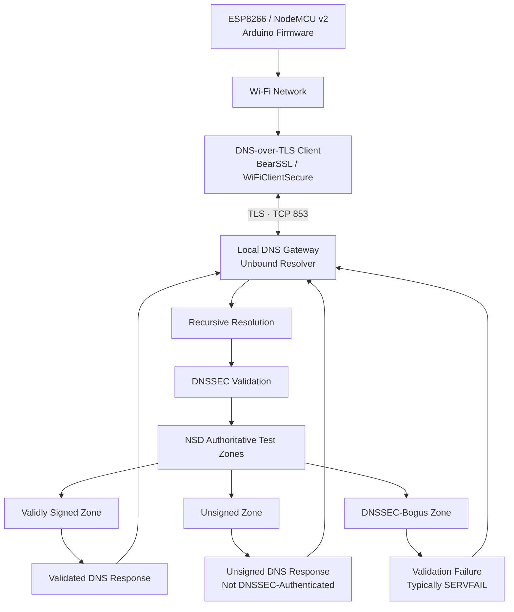

# 🔐 Gateway-Assisted DNSSEC for ESP8266 IoT Devices

### AIORI-3 Hackathon · PS-004 · Team TC200

**Bringing authenticated DNS resolution to resource-constrained IoT devices through a secure, gateway-assisted architecture.**

[](#technology-stack)
[](#technology-stack)
[](#dnssec-validation)
[](#dns-over-tls)
[](#about-the-project)

> **Project status:** Prototype with gateway-assisted DNSSEC infrastructure configured and DNS-over-TLS testing performed. The project combines an ESP8266 IoT client, a local Unbound validating resolver, and NSD-hosted DNS test zones to explore secure DNS resolution for resource-constrained devices.

---
## Team Introduction Video

**Problem Statement:** PS-004 — Authenticated Gateway-Assisted DNSSEC for IoT Clients

**Video:** [Watch our AIORI-3 team introduction](https://youtu.be/wjA9g5x5s4w?si=8qdF-Wcldh8SVMxA)

## 🎬 Demo & Submission Resources

| Resource | Details |
|---|---|
| Team introduction video | **Updated** — [Watch the team introduction video](YOUR_PUBLISHED_TEAM_VIDEO_URL) |
| Project repository | [A3-PS004-TC200](https://github.com/aiori-hackathon/A3-PS004-TC200) |
| Problem statement | PS-004 — Gateway-Assisted DNSSEC for ESP8266 IoT Devices |
| Hackathon | AIORI-3 |
| Team code | TC200 |

*Replace `YOUR_PUBLISHED_TEAM_VIDEO_URL` with the actual published video URL before committing this README. The link was not included in the information provided for this revision.*

---

## 📌 Table of Contents

- [About the Project](#about-the-project)
- [Problem Statement](#problem-statement)
- [Our Solution](#our-solution)
- [Key Features](#key-features)
- [System Architecture](#system-architecture)
- [End-to-End Workflow](#end-to-end-workflow)
- [Technology Stack](#technology-stack)
- [DNS-over-TLS](#dns-over-tls)
- [DNSSEC Validation](#dnssec-validation)
- [Testing and Results](#testing-and-results)
- [Repository Structure](#repository-structure)
- [Installation and Setup](#installation-and-setup)
- [Gateway Configuration and Validation](#gateway-configuration-and-validation)
- [Security Design](#security-design)
- [Challenges and Engineering Decisions](#challenges-and-engineering-decisions)
- [Future Enhancements](#future-enhancements)
- [Team and Acknowledgements](#team-and-acknowledgements)

---

## 1. About the Project

The Domain Name System (DNS) is a foundational component of Internet connectivity, but conventional DNS queries do not inherently provide cryptographic authentication of DNS data or confidentiality for the communication channel.

This creates a security challenge for Internet of Things (IoT) devices, which frequently operate with limited memory, processing power, and energy budgets.

**Gateway-Assisted DNSSEC for ESP8266 IoT Devices** explores a practical alternative: move DNSSEC validation to a local gateway while using DNS-over-TLS (DoT) to protect DNS queries between the IoT device and the gateway.

The prototype integrates:

- **ESP8266 / NodeMCU v2:** the resource-constrained IoT client.
- **Unbound:** a recursive DNS resolver configured for DNSSEC validation and DNS-over-TLS service.
- **NSD:** an authoritative DNS server hosting controlled test zones.
- **BearSSL / WiFiClientSecure:** the TLS client facilities available in the ESP8266 Arduino environment.
- **PlatformIO:** the firmware build, upload, and serial-monitoring workflow.

The project evaluates how transport encryption and gateway-side DNSSEC validation can work together without requiring the ESP8266 to implement a complete DNSSEC validation engine itself.

## 2. Problem Statement

**PS-004: Gateway-Assisted DNSSEC for ESP8266 IoT Devices**

Traditional DNS relies on a resolver's response without inherently authenticating the origin and integrity of DNS records. DNSSEC addresses this problem through cryptographic signatures and a chain of trust.

However, implementing complete DNSSEC validation on a constrained microcontroller can increase implementation complexity and resource requirements.

Our project investigates three related questions:

1. Can an ESP8266 communicate with a local DNS gateway using encrypted DNS-over-TLS?
2. Can the gateway use Unbound to perform DNSSEC validation for controlled test domains?
3. Can validly signed, unsigned, and DNSSEC-bogus DNS data be distinguished through repeatable tests?

The objective is to demonstrate a modular security architecture in which the IoT client establishes a protected connection to a trusted gateway, and the gateway handles DNS resolution and DNSSEC validation.

## 3. Our Solution

We use a gateway-assisted architecture that separates transport security from DNS data authentication.

**At the device:** The ESP8266 connects to Wi-Fi and uses a TLS client to communicate with the configured DNS gateway.

**At the gateway:** Unbound handles recursive resolution and DNSSEC validation. NSD supplies authoritative responses for controlled test zones.

**During evaluation:** DNS queries are tested against validly signed, unsigned, and deliberately invalid DNSSEC scenarios to examine resolver behavior.

The design aims to provide a practical security layer for IoT devices while keeping the resource-intensive DNSSEC validation process at the gateway.

### Why gateway-assisted DNSSEC?

| Design challenge | Our approach |
|---|---|
| Limited microcontroller resources | Perform DNSSEC validation at the gateway |
| DNS query confidentiality | Use DNS-over-TLS |
| Resolver authentication | Configure CA trust and hostname verification on the client |
| DNS response integrity and authenticity | Use DNSSEC validation in Unbound |
| Reproducible security evaluation | Maintain controlled DNS test zones with NSD |
| Firmware development and debugging | Use PlatformIO and serial monitoring |

## 4. Key Features

- **Gateway-assisted DNS security:** separates the IoT client from the DNSSEC validation workload.
- **Encrypted DNS transport:** uses DNS-over-TLS over TCP port `853`.
- **Certificate-based trust:** firmware is configured with a CA certificate for gateway authentication.
- **Recursive DNS resolution:** uses Unbound as the gateway resolver.
- **Controlled DNSSEC scenarios:** prepared test zones cover valid signatures, unsigned data, and bogus DNSSEC data.
- **Embedded firmware:** developed for ESP8266 / NodeMCU v2 using the Arduino framework.
- **Reproducible development workflow:** PlatformIO commands support building, uploading, and capturing serial output.
- **Security-conscious configuration:** local secrets and private keys are excluded from version control.

## 5. System Architecture



### Architecture components

| Component | Responsibility |
|---|---|
| ESP8266 / NodeMCU v2 | Initiates DNS requests from the IoT device |
| Wi-Fi / local network | Connects the device to the gateway |
| BearSSL / WiFiClientSecure | Provides TLS client functionality |
| CA trust anchor | Establishes the configured trust basis for the gateway certificate |
| Unbound | Performs recursive DNS resolution and DNSSEC validation |
| NSD | Serves authoritative records for the controlled test zones |
| DNSSEC test zones | Exercise valid, unsigned, and bogus DNS data |

**Security model:** DoT and DNSSEC solve different problems. DoT protects the connection to the selected resolver; DNSSEC authenticates DNS data through its signature-validation chain.

The diagram describes the intended data path. A complete end-to-end demonstration requires evidence that the device's TLS connection, certificate verification, DNS query exchange, and gateway validation all work together.

## 6. End-to-End Workflow

1. The ESP8266 connects to the configured Wi-Fi network.
2. The client resolves or otherwise obtains the gateway's network address.
3. The device opens a TCP connection to the gateway's DoT service on port `853`.
4. The TLS client validates the gateway certificate against the configured CA and verifies the expected hostname.
5. The gateway receives the DNS query through the encrypted channel.
6. Unbound performs recursive resolution and applies DNSSEC validation.
7. NSD-hosted test zones supply the controlled authoritative DNS data.
8. Unbound returns the corresponding result through the gateway's DNS-over-TLS service.
9. The client-side serial output and gateway-side logs are captured for analysis.

Steps 3–4 depend on successful TLS establishment and certificate verification. The DNSSEC outcomes are evaluated separately to avoid confusing encrypted transport with authenticated DNS data.

## 7. Technology Stack

| Technology | Purpose |
|---|---|
| ESP8266 / NodeMCU v2 | IoT client hardware |
| C++ / Arduino framework | Embedded firmware |
| PlatformIO | Build system, firmware upload, serial monitoring |
| BearSSL / `WiFiClientSecure` | TLS client support |
| Unbound | Recursive resolver and DNSSEC validator |
| NSD | Authoritative DNS test server |
| DNSSEC | DNS data authentication and integrity |
| DNS-over-TLS | Encrypted DNS transport |
| Ubuntu on WSL2 | Gateway configuration and service development |

## 8. DNS-over-TLS

DNS-over-TLS encrypts DNS messages between the client and its configured resolver using TLS.

The conventional DoT service port is **TCP `853`**.

In this project, the ESP8266 firmware uses the ESP8266 Arduino TLS client facilities, while Unbound is configured to provide a TLS-enabled DNS service.

### TLS verification requirements

A successful connection should establish all of the following:

- The gateway is reachable over TCP.
- The TLS handshake completes successfully.
- The gateway certificate chains to a trusted CA.
- The certificate matches the hostname the client intends to reach.
- DNS messages are exchanged through the established encrypted connection.

A successful Wi-Fi connection alone does not demonstrate DoT. Likewise, a completed TLS handshake without proper certificate and hostname verification does not establish authenticated gateway identity.

### Testing approach

The DoT test process includes gateway configuration checks, network reachability checks, TLS testing from a separate client, and firmware-level testing using serial logs.

**Reported result:** DNS-over-TLS testing has been performed as part of the prototype evaluation. The test record should distinguish a successful TLS connection from successful ESP8266-side certificate verification and complete DNS query/response exchange.

## 9. DNSSEC Validation

DNSSEC uses digital signatures to authenticate DNS data. A validating resolver checks the relevant signatures and trust chain before accepting data as authenticated.

This project uses Unbound for validation and NSD to host controlled DNS test zones.

### Test scenarios

| Scenario | Expected resolver behavior | Security interpretation |
|---|---|---|
| Validly signed zone | Resolution succeeds when the chain of trust validates | DNS data can be authenticated |
| Unsigned zone | Resolution may succeed, depending on zone delegation and resolver policy | Successful resolution does not imply DNSSEC authentication |
| DNSSEC-bogus zone | Validation fails, typically with `SERVFAIL` | Invalid DNSSEC data is rejected |

### Why these tests matter

A DNS security implementation must distinguish three different outcomes:

- **Authenticated data:** signatures and the trust chain validate.
- **Available but unauthenticated data:** resolution succeeds without DNSSEC authentication.
- **Invalid data:** validation fails and the resolver rejects the bogus response.

These scenarios help evaluate whether the gateway applies DNSSEC validation as intended rather than simply forwarding DNS responses.

## 10. Testing and Results

The prototype is evaluated at two layers: gateway infrastructure and ESP8266 client integration.

### Test summary

| Test | Purpose | Evidence to retain |
|---|---|---|
| Firmware build | Verify that the project compiles | PlatformIO build output |
| Wi-Fi connectivity | Confirm network access | ESP8266 serial log |
| Unbound configuration | Validate resolver configuration | `unbound-checkconf` output |
| DoT service | Confirm the TLS-enabled DNS service is reachable | Listener check and TLS client output |
| TLS trust verification | Verify certificate chain and hostname | Client verification output |
| Valid DNSSEC data | Confirm successful validation | DNS query and resolver logs |
| Unsigned DNS data | Confirm expected unsigned-zone behavior | DNS query and resolver logs |
| DNSSEC-bogus data | Confirm validation failure | `SERVFAIL` response and resolver logs |
| ESP8266 integration | Verify the complete client-to-gateway path | Serial output and gateway logs |

### Results interpretation

The current prototype includes Wi-Fi connectivity, configured resolver infrastructure, prepared DNSSEC test zones, and reported DoT testing.

The test matrix above specifies the evidence needed for each security property. A test should be marked **PASS** only when the corresponding output has been captured and verified.

In particular, a gateway-level TLS test does not by itself prove that the ESP8266 successfully verifies the certificate, and a successful DoT exchange does not by itself prove that the returned DNS data passed DNSSEC validation.

### Recommended evidence format

For every test run, record:

- Test ID and date.
- Query name and record type.
- DNSSEC scenario.
- Test environment and gateway configuration.
- Actual DNS response or TLS result.
- Certificate verification outcome, where applicable.
- Relevant sanitized client and server logs.
- Final pass/fail status.

This evidence-first approach makes the demonstration easier to reproduce and gives reviewers a clear distinction between configured components and verified outcomes.

## 11. Repository Structure

```text
A3-PS004-TC200/
├── .vscode/
├── include/
├── lib/
├── src/
│   ├── main.cpp
│   └── ca_cert.h
├── test/
├── .gitignore
├── platformio.ini
├── README.md
└── A3-PS004-TC200 Authenticated Gateway-Assisted DNSSEC for IoT ClientS.pdf
```

### Important files

| File | Purpose |
|---|---|
| `src/main.cpp` | ESP8266 firmware entry point |
| `src/ca_cert.h` | CA certificate used by the firmware |
| `platformio.ini` | PlatformIO board and build configuration |
| `.gitignore` | Excludes local secrets and build artifacts |
| `test/` | Location for project tests |
| Project PDF | Hackathon submission document |

A local `src/secrets.h` may be required by the firmware configuration. It should remain untracked and must never contain credentials committed to the repository.

## 12. Installation and Setup

### Prerequisites

- Visual Studio Code.
- PlatformIO IDE extension.
- ESP8266 / NodeMCU v2 board.
- USB data cable.
- Wi-Fi access shared by the device and gateway.
- A configured gateway certificate and corresponding CA trust anchor.
- Ubuntu on WSL2 or another supported Linux environment for gateway services.

### Step 1: Clone the repository

```bash
git clone https://github.com/aiori-hackathon/A3-PS004-TC200.git
cd A3-PS004-TC200
```

### Step 2: Configure local secrets

If the firmware expects `src/secrets.h`, create it locally using the exact macro names referenced in `src/main.cpp`.

Use your own Wi-Fi credentials and gateway settings. Do not commit the file.

Ensure that the CA certificate in `src/ca_cert.h` matches the certificate authority intended to authenticate the gateway certificate.

### Step 3: Build the firmware

```bash
pio run
```

Resolve any compiler or dependency errors before uploading.

### Step 4: Upload to the ESP8266

```bash
pio run --target upload
```

Close any existing serial monitor if it is occupying the board's serial port.

### Step 5: Monitor the device

```bash
pio device monitor --baud 115200
```

Capture the serial output for Wi-Fi connectivity, gateway hostname resolution, TCP/TLS setup, certificate verification, and DNS responses.

## 13. Gateway Configuration and Validation

Before testing the ESP8266, verify the gateway independently.

### Validate Unbound

```bash
sudo unbound-checkconf
```

The command should complete without configuration errors.

### Check the DoT listener

```bash
sudo ss -lntp | grep ':853'
```

Confirm that the service is listening on the expected interface and port.

### Inspect the gateway certificate

```bash
openssl x509 -in gw.crt -noout -subject -issuer -dates -ext subjectAltName
```

Replace `gw.crt` with the actual gateway certificate path.

Check that the certificate is valid for the intended hostname and that its validity period covers the test date.

### Test TLS with certificate verification

From a machine that trusts the gateway's issuing CA:

```bash
openssl s_client \
  -connect GATEWAY_IP:853 \
  -servername gateway.lab \
  -CAfile ca.crt \
  -verify_hostname gateway.lab \
  -verify_return_error
```

Replace `GATEWAY_IP`, `gateway.lab`, and `ca.crt` with the actual gateway address, certificate hostname, and CA certificate path.

This checks TLS certificate validation from the separate test client. It does not replace the need to test certificate verification in the ESP8266 firmware.

### Verify DNSSEC outcomes

Query the controlled test domains through Unbound using a DNS client that supports DNS-over-TLS, and capture the actual responses and resolver logs.

Use the configured test-zone names rather than assuming that example names or records are present in the local environment.

## 14. Security Design

The implementation follows several security principles.

**Certificate verification stays enabled.** Certificate errors should be fixed through correct CA trust, hostname configuration, certificate validity, and network setup—not by disabling verification.

**Transport security and DNSSEC are evaluated independently.** TLS protects the connection to the resolver; DNSSEC validates signed DNS data.

**Trust anchors are explicit.** The CA certificate used by the device must correspond to the intended gateway certificate chain.

**Private material stays private.** Gateway private keys, CA private keys, zone-signing keys, Wi-Fi credentials, and tokens must never be committed to the repository.

**Test results remain evidence-based.** A configuration that passes validation is not automatically equivalent to a successfully demonstrated end-to-end security property.

## 15. Challenges and Engineering Decisions

### Resource constraints on the ESP8266

The ESP8266 has tighter memory and processing constraints than a typical Linux gateway. Delegating DNSSEC validation to Unbound allows the firmware to focus on secure transport and request handling.

### Gateway hostname resolution

A hostname-based TLS connection requires the device to resolve the gateway hostname or otherwise obtain its address. The configured certificate must match the hostname verified by the client.

Local DNS configuration, network routing, and hostname resolution therefore form part of the end-to-end integration.

### Certificate trust

TLS encryption alone is insufficient if the client does not authenticate the server. The project uses a configured CA trust anchor and retains certificate and hostname verification as requirements.

### Reproducible DNSSEC testing

Controlled NSD-hosted zones make it possible to test signed, unsigned, and bogus DNS data without relying exclusively on external domains whose configuration may change.

## 16. Future Enhancements

- Complete and document the ESP8266-to-gateway DoT integration.
- Capture explicit evidence of certificate-chain and hostname verification on the device.
- Run the complete DNSSEC test matrix through the gateway.
- Automate repeatable TLS and DNSSEC test execution.
- Measure query latency, TLS setup time, memory consumption, and failure behavior.
- Add sanitized gateway configuration examples and a reproducible demonstration guide.
- Complete the submission documentation and maintain the published team video link.

## 17. Team and Acknowledgements

**Team:** TC200  
**Hackathon:** AIORI-3  
**Problem statement:** PS-004 — Gateway-Assisted DNSSEC for ESP8266 IoT Devices

### Project deliverables

- ESP8266 firmware and PlatformIO project.
- Gateway-assisted DNS security architecture.
- Unbound resolver and NSD test-zone configuration.
- DNS-over-TLS and DNSSEC test plan.
- Project documentation and submission PDF.
- Team introduction video.

We acknowledge the AIORI-3 hackathon initiative for the opportunity to explore practical security challenges in IoT and Internet infrastructure.

---

## Final Note

This project explores how secure DNS transport and gateway-side DNSSEC validation can be combined for resource-constrained IoT devices. The objective is not simply to establish an encrypted connection, but to build and evaluate a complete, reproducible trust path from the IoT client to the validating resolver.

**Secure transport. Authenticated DNS data. A practical architecture for IoT.**
