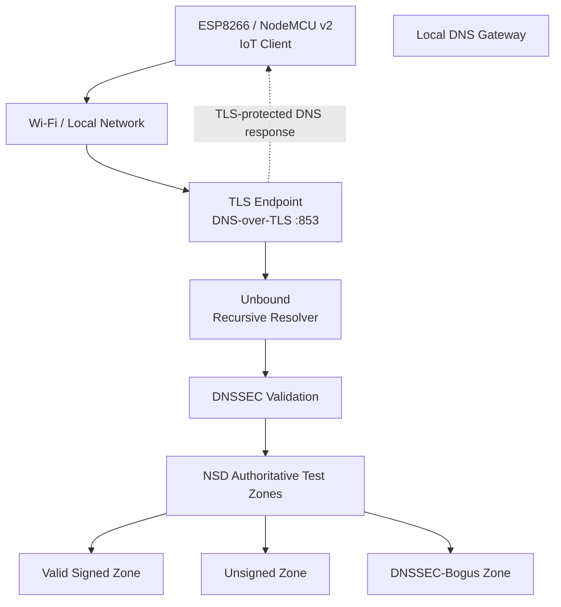

# PS-004 — System Architecture

## 1. Overview

The PS-004 project explores a gateway-assisted DNS security architecture for resource-constrained IoT devices. It combines an ESP8266 NodeMCU client, a local gateway running Unbound, NSD-hosted DNS test zones, DNSSEC validation, and DNS-over-TLS (DoT).

The design delegates DNSSEC validation to the gateway rather than requiring the ESP8266 to perform the complete validation process itself. The connection between the client and gateway is intended to use TLS with certificate-chain and hostname verification.

**Implementation status:** The gateway-side configuration and independent TLS verification have been tested. Complete ESP8266-to-gateway DoT communication and end-to-end DNSSEC testing remain in progress.

## 2. High-Level Architecture



*The diagram illustrates the intended architecture, not a claim that the complete device-to-gateway path is already operational.*

## 3. Component Responsibilities

| Component | Responsibility |
|---|---|
| ESP8266 / NodeMCU v2 | Generates DNS requests and acts as the constrained IoT client |
| Wi-Fi / local network | Provides network connectivity between the device and gateway |
| DNS-over-TLS endpoint | Accepts DNS messages over a TLS-protected TCP connection on port `853` |
| BearSSL / `WiFiClientSecure` | Provides TLS client functionality in the ESP8266 firmware |
| CA certificate | Establishes the trust anchor used to verify the gateway certificate |
| Unbound | Performs recursive DNS resolution and DNSSEC validation |
| NSD | Serves authoritative records for controlled DNS test zones |
| DNSSEC test zones | Provide signed, unsigned, and DNSSEC-bogus scenarios |

## 4. DNS Query Flow

The intended query lifecycle is as follows:

1. The ESP8266 joins the configured Wi-Fi network.
2. The device resolves the gateway hostname and determines how to reach the gateway.
3. The firmware establishes a TLS connection to the gateway on TCP port `853`.
4. The client verifies the gateway certificate chain and hostname.
5. The client sends a DNS message over the TLS connection using DNS-over-TCP message framing.
6. Unbound processes the query and performs recursive resolution and DNSSEC validation.
7. NSD provides authoritative records for the relevant test zones.
8. Unbound returns the resolver response through the gateway's TLS endpoint.
9. The ESP8266 reads the response and reports the result through its serial interface.

Steps involving successful ESP8266 TLS communication, DNS message transmission, and response handling must be verified through device logs before being considered complete.

## 5. DNSSEC and TLS: Different Security Layers

DNSSEC and DoT protect different parts of the system.

| Security mechanism | What it protects | Where it applies |
|---|---|---|
| DNSSEC | Authenticity and integrity of DNS data through cryptographic validation | Recursive resolver |
| DNS-over-TLS | DNS traffic in transit between the client and resolver | ESP8266-to-gateway connection |
| TLS certificate verification | Authentication of the gateway's TLS identity | ESP8266 TLS client |
| Hostname verification | Checks that the certificate matches the intended gateway hostname | ESP8266 TLS client |

**Important:** An encrypted DNS connection does not, by itself, prove that the DNS data is authentic. DNSSEC validation and TLS authentication are complementary protections.

## 6. DNSSEC Test Architecture

The project uses controlled DNS test zones to evaluate resolver behavior.

| Test scenario | Expected behavior |
|---|---|
| Valid signed data | Resolution succeeds when the DNSSEC chain validates |
| Unsigned data | Resolution may succeed, but the data is not DNSSEC-authenticated |
| DNSSEC-bogus data | Validation fails, typically resulting in `SERVFAIL` |

These are expected outcomes. Each scenario must be queried through the configured validating resolver, and the actual response and validation evidence must be recorded.

## 7. Certificate and Trust Model

The gateway presents a TLS server certificate. The ESP8266 firmware is configured to use a CA certificate from `src/ca_cert.h` as its trust anchor.

For the intended authenticated connection to work:

- The gateway must be reachable on TCP port `853`.
- The gateway hostname must resolve correctly from the device's network.
- The server certificate must chain to the configured trusted CA.
- The requested hostname must match a name in the certificate's Subject Alternative Name (SAN).
- TLS certificate verification must remain enabled.

The CA certificate is public trust material, but the gateway private key and CA private key must never be committed to the repository.

## 8. Repository Components

```text
A3-PS004-TC200/
├── src/
│   ├── main.cpp
│   └── ca_cert.h
├── docs/
│   ├── architecture.md
│   └── testing.md
├── platformio.ini
├── .gitignore
└── README.md
```

- `src/main.cpp` — ESP8266 firmware and TLS client logic.
- `src/ca_cert.h` — CA certificate used by the firmware.
- `docs/testing.md` — Test procedures, observed results, and validation status.
- `platformio.ini` — PlatformIO board and build configuration.
- `.gitignore` — Excludes local secrets and generated files.
- `README.md` — Project overview, objectives, architecture summary, and results.

## 9. Current Implementation Status

### Completed or configured

- ESP8266 firmware project and Wi-Fi connectivity.
- Unbound configuration validation.
- NSD-hosted DNSSEC test-zone preparation.
- Gateway TLS endpoint configuration.
- Independent WSL TLS verification using CA trust and hostname verification.

### In progress

- Reliable gateway hostname resolution from the ESP8266.
- Successful ESP8266-to-gateway DoT communication.
- Device-side DNS query and response handling over TLS.
- End-to-end validation of signed, unsigned, and DNSSEC-bogus data.

## 10. Related Documentation

- [Project README](../README.md)
- [Testing and Validation](testing.md)

---

*This document describes the intended architecture and the implementation status currently supported by test evidence. Update it as integration and validation progress.*